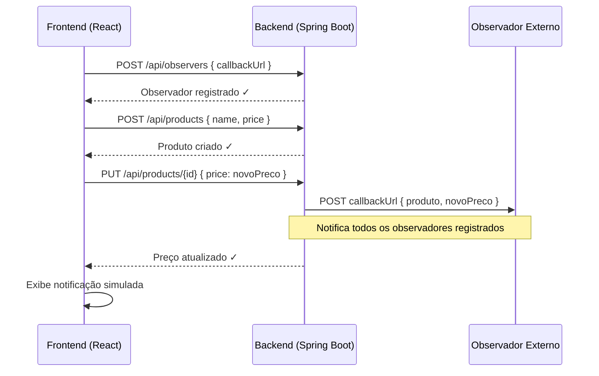
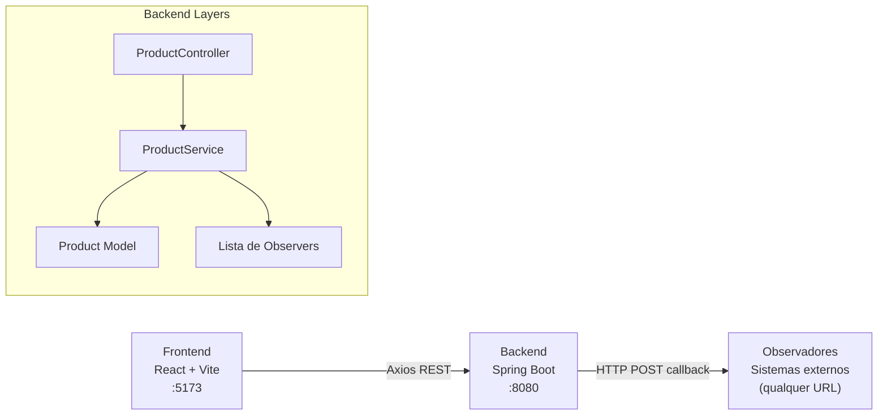

# Sistema Observer de Preços

Aplicação full-stack que demonstra o **padrão de projeto Observer** aplicado a um cenário real de monitoramento de preços. Sistemas externos se registram como observadores e são notificados automaticamente via callback HTTP sempre que o preço de um produto é alterado.

[](https://openjdk.org/projects/jdk/17/)
[](https://spring.io/projects/spring-boot)
[](https://react.dev)
[](https://vitejs.dev)
[](http://localhost:8080/swagger-ui.html)
[](LICENSE)

---

## Como funciona o padrão Observer aqui



---

## Arquitetura



---

## Funcionalidades

- **Registrar observador** — qualquer sistema pode se inscrever informando sua URL de callback
- **Remover observador** — cancela inscrição de um callback registrado
- **Cadastrar produto** — adiciona produto com nome e preço
- **Atualizar preço** — dispara notificação automática para todos os observadores registrados
- **Listar produtos** — exibe todos os produtos cadastrados
- **Painel de notificações** — histórico das notificações simuladas no frontend

---

## Stack Tecnológica

| Camada | Tecnologia | Versão |
|---|---|---|
| Frontend | React | 18 |
| Frontend | Vite | 5 |
| Frontend | Axios | — |
| Backend | Java | 17 |
| Backend | Spring Boot | 3.4.5 |
| Backend | Springdoc OpenAPI | 2.3.0 |

---

## Como Executar

### Com Docker (recomendado)

```bash
git clone https://github.com/odavid062/Padrao-Observer-.git
cd Padrao-Observer-
docker compose up --build
```

| Serviço | URL |
|---|---|
| Frontend | http://localhost:5173 |
| Backend | http://localhost:8080 |
| Swagger | http://localhost:8080/swagger-ui.html |

### Manualmente

**Backend:**
```bash
cd back-end
./mvnw spring-boot:run
```

**Frontend:**
```bash
cd front-end
npm install
npm run dev
```

---

## Endpoints da API

| Método | Rota | Descrição |
|---|---|---|
| `GET` | `/api/products` | Lista todos os produtos |
| `POST` | `/api/products` | Cadastra novo produto |
| `PUT` | `/api/products/{id}` | Atualiza preço (dispara notificações) |
| `POST` | `/api/observers` | Registra observador com callback URL |
| `DELETE` | `/api/observers` | Remove observador |

### Exemplos

```bash
# Registrar observador
curl -X POST http://localhost:8080/api/observers \
  -H "Content-Type: application/json" \
  -d '{"callbackUrl": "http://meu-sistema.com/notificacao"}'

# Cadastrar produto
curl -X POST http://localhost:8080/api/products \
  -H "Content-Type: application/json" \
  -d '{"name": "Café Especial", "price": 49.90}'

# Atualizar preço — dispara callback para todos os observadores
curl -X PUT http://localhost:8080/api/products/1 \
  -H "Content-Type: application/json" \
  -d '{"price": 39.90}'
```

---

## Estrutura do Projeto

```
Padrao-Observer-/
├── back-end/                            # Spring Boot API
│   └── src/main/java/com/example/Observer/
│       ├── controller/
│       │   └── ProductController.java   # Endpoints REST
│       ├── model/
│       │   └── Product.java             # Entidade produto
│       ├── service/
│       │   └── ProductService.java      # Lógica Observer + callbacks
│       └── ObserverApplication.java
├── front-end/                           # React + Vite SPA
│   └── src/
│       ├── App.jsx                      # Componente principal
│       └── main.jsx
├── docker-compose.yml
└── README.md
```

---

## Documentação Interativa (Swagger)

```
http://localhost:8080/swagger-ui.html
```

---

## Autor

**David Rodrigues**
[](https://github.com/odavid062)
